# Smart Attendance Management System (AMS)

A full-stack attendance system for colleges. Students mark attendance by scanning a **rotating QR code** shown by the teacher, so a photo of the QR sent to an absent friend does not work. Dashboards for students, faculty and admins show subject-wise attendance, flag anyone below 75%, and use an **early-warning model** to predict who is likely to fall short.

**Live demo:** https://ams-frontend-rzi6.onrender.com/pages/login.html

> The demo runs on free hosting. If nobody has used it for 15 minutes the server goes to sleep, so the **first login can take up to 2 minutes**. After that it is fast.

## Screenshots

|                                                                                                          |                                                                                                     |
| -------------------------------------------------------------------------------------------------------- | --------------------------------------------------------------------------------------------------- |
| **Login** <br> 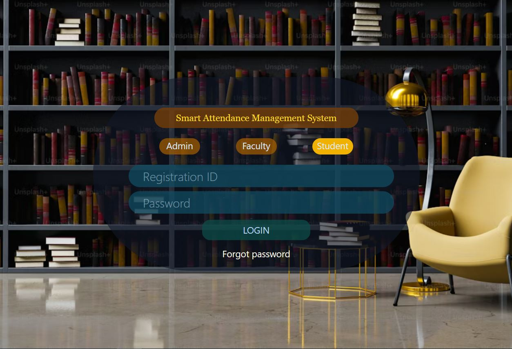                                        | **Student dashboard** <br> 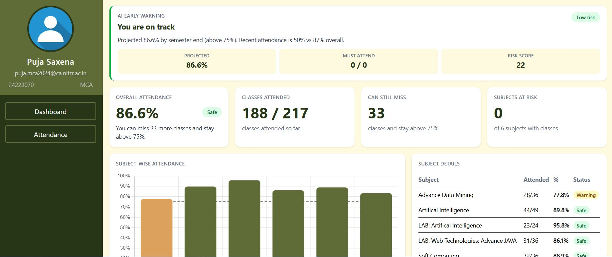         |
| **Student: subject-wise details** <br> 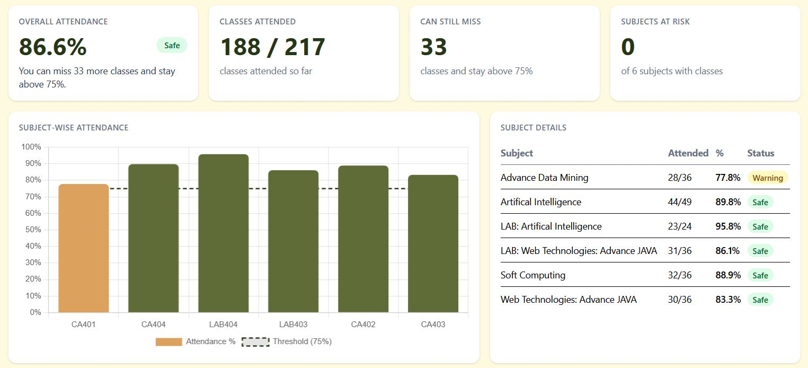  | **Student: today's classes** <br> 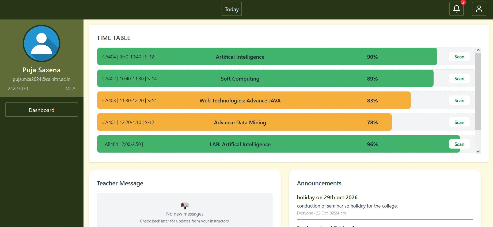   |
| **Faculty dashboard** <br> 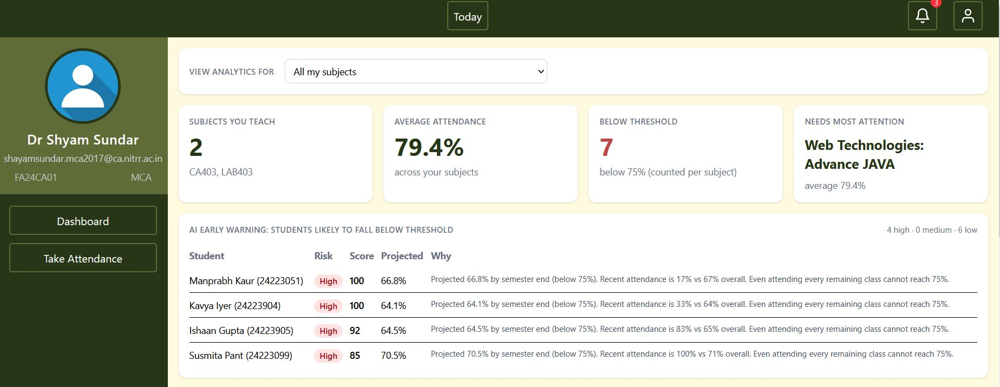              | **Faculty: at-risk students** <br> 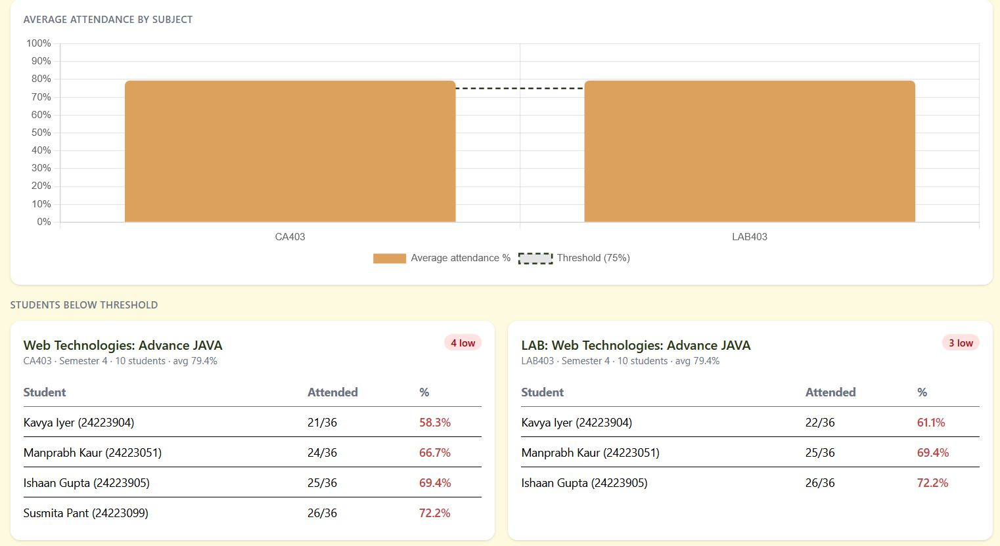 |
| **Faculty: take attendance** <br> 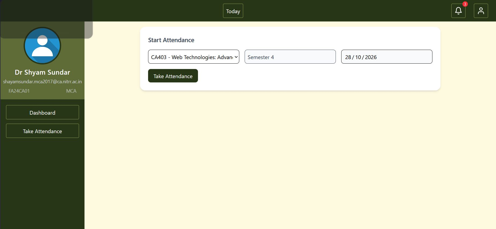      | **Rotating QR session** <br> 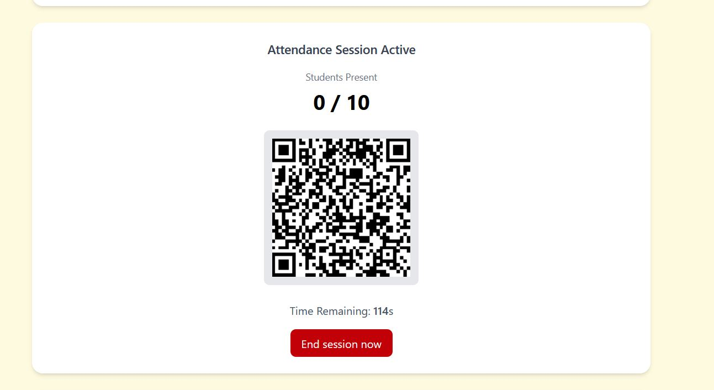           |
| **QR session with live check-in list** <br> 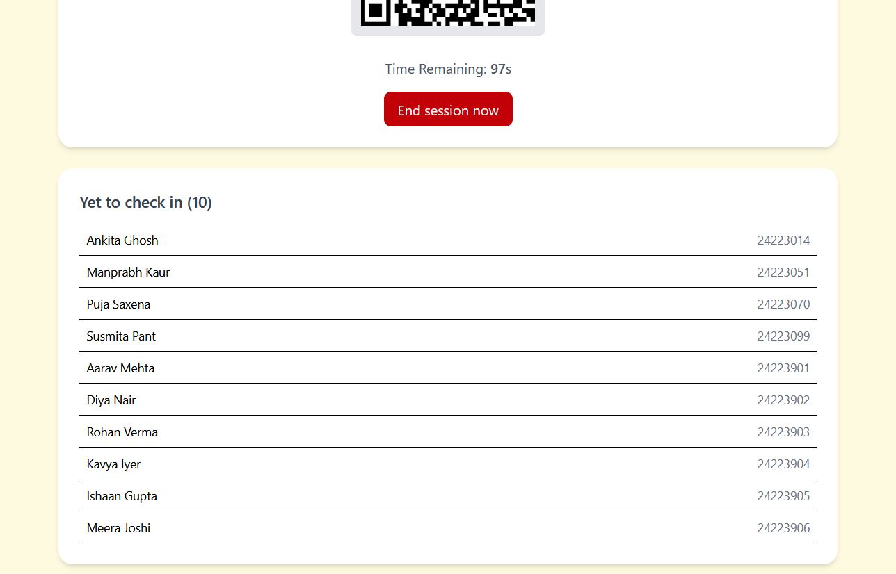 | **Faculty: today's classes** <br> 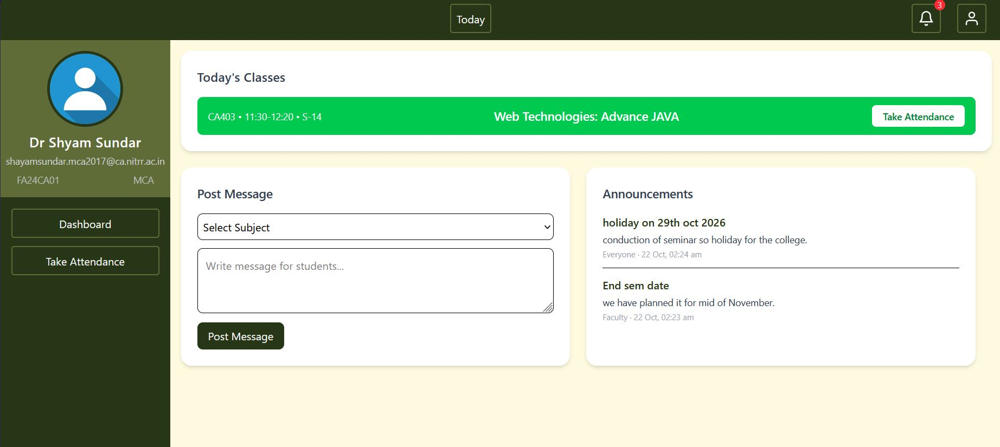   |
| **Admin dashboard** <br> 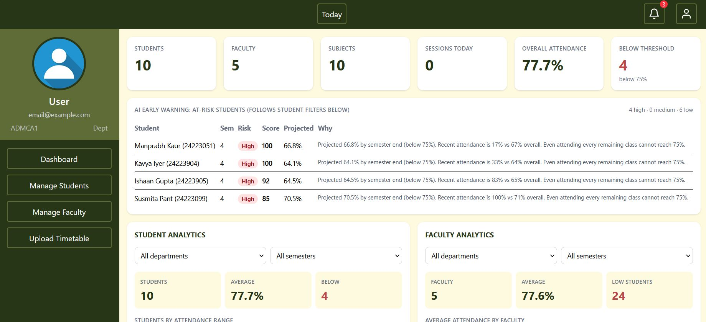                  | **Admin: analytics** <br> 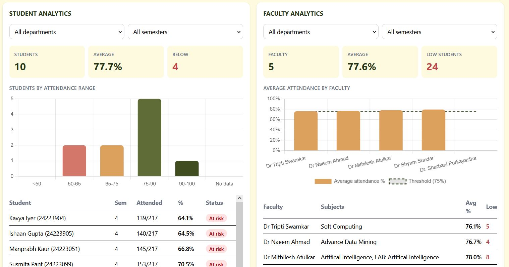            |
| **Admin: today and announcements** <br> 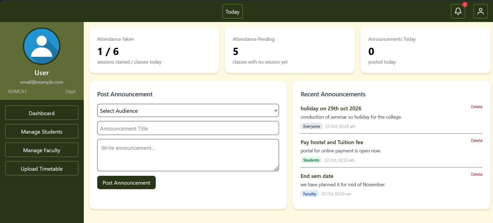    |                                                                                                     |

## Features

- **Anti-proxy attendance:** the QR code changes every few seconds and is tied to the logged-in student, so screenshots and forwarded codes are rejected.
- **Role-based access** for Student, Faculty and Admin, enforced on the server.
- **Student dashboard:** overall and subject-wise percentage, a "classes you can still miss" figure, and subjects at risk.
- **Faculty dashboard:** analytics for the subjects they teach, with a subject filter and a list of students below 75%.
- **Take attendance:** a session with a countdown, a live count, and a list of students who have not yet checked in. Absentees are marked when the session ends.
- **Admin dashboard:** college-wide analytics filtered by department and semester, user management, timetable upload, and announcements that appear on student and faculty pages.
- **AI early warning:** a risk score and a projected end-of-semester percentage for each student, with a plain-language reason.

## How it works

**Rotating QR.** When a teacher starts a session, the server creates a session id. The QR contains the session id plus a short-lived token signed with HMAC-SHA256 (valid for a 10-second window). When a student scans it, the server checks the signature and the time window, reads the student's identity from their login token (not from anything the phone sends), and records one attendance row per student, subject and day.

**Early warning.** For each student the model combines overall attendance with the most recent classes (a weighted rate), projects the final percentage using the classes remaining in the semester (taken from the timetable), and turns the gap to the 75% threshold into a risk score. Students are shown as High, Medium or Low risk, and anyone who cannot reach 75% even by attending every remaining class is flagged High. With very little data it says "not enough data" instead of guessing.

## Architecture

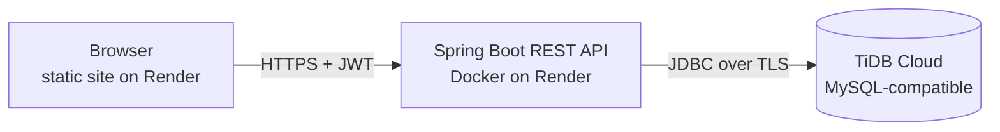

## Tech stack

| Layer    | Technology                                                                                |
| -------- | ----------------------------------------------------------------------------------------- |
| Backend  | Java 17, Spring Boot, Spring Security (stateless JWT), Spring Data JPA / Hibernate, Maven |
| Database | MySQL 8 locally, TiDB Cloud (MySQL-compatible) in the cloud                               |
| Frontend | HTML, JavaScript, Tailwind CSS, Chart.js, html5-qrcode, qrcode.js                         |
| Hosting  | Render (Docker web service + static site), TiDB Cloud Starter                             |

## Security

- Passwords stored with BCrypt; stateless JWT authentication.
- Role checks on every endpoint (admin-only user creation, faculty-only session control, students can only read their own attendance).
- Secrets (database password, JWT secret) come from environment variables, not from the code.
- Attendance identity comes from the verified login token, not from request data.

## Run it locally

You need Java 17, Maven, MySQL 8 and Node.js.

1. Create a database named `ams_db` in MySQL.
2. Set these environment variables, then start the backend from `backend/amsbackend` with `mvn spring-boot:run` (or run it from IntelliJ):

   | Variable                 | Meaning                                   |
   | ------------------------ | ----------------------------------------- |
   | `DB_URL`                 | e.g. `jdbc:mysql://localhost:3306/ams_db` |
   | `DB_USER`, `DB_PASSWORD` | your MySQL login                          |
   | `JWT_SECRET`             | a long random string                      |
   | `AMS_SEMESTER_END_DATE`  | optional, e.g. `2026-04-16`               |

   The tables are created automatically on first start. Sample data for a semester is in `database/seed_semester4_history.sql`.

3. Serve the frontend from the project root (VS Code Live Server, or `python -m http.server 5500`) and open `http://127.0.0.1:5500/src/pages/login.html`. It talks to the backend on port 8081 when opened from your own machine.
4. If you change styling classes, run `npm install` once and `npm run dev` to rebuild `src/css/output.css`.

## Project structure

```
backend/amsbackend/   Spring Boot API (controllers, services, repositories, security)
src/pages/            HTML pages (login, dashboards, today, attendance)
src/js/               Page scripts and shared helpers
src/css/              Tailwind output
database/             Sample data scripts
docs/screenshots/     Screenshots used in this README
```

## Demo logins

| Role    | ID         | Password          |
| ------- | ---------- | ----------------- |
| Student | `24223070` | `<DEMO PASSWORD>` |
| Faculty | `FA24CA01` | `<DEMO PASSWORD>` |

## Roadmap

- Per-student subject enrollment (for open electives)
- Device binding for extra proxy protection
- Email-based password reset
- Automated tests and CI

## Author

**Puja**, MCA, NIT Raipur
